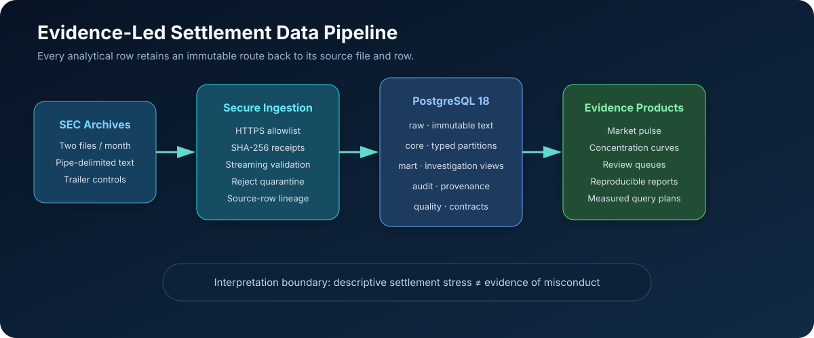

# SQL Market Settlement Forensics

[](https://github.com/JithuVathiath/sql-market-settlement-forensics/actions/workflows/ci.yml)
[](https://go.dev/)
[](https://www.postgresql.org/docs/18/)
[](LICENSE)

An audit-ready, SQL-first investigation system for the U.S. SEC's fails-to-deliver dataset. It turns awkward half-month text archives into a typed, partitioned PostgreSQL warehouse with reproducible lineage, statistical review queues, data-quality assertions, and measured index experiments.

> Fails-to-deliver data describe aggregate net balances outstanding on each settlement date. They do **not** identify an underlying party or establish short selling, naked short selling, manipulation, or misconduct.

## Verified Result

The committed [February 2021 validation report](reports/february-2021-profile.md) was produced from two complete SEC-format files pinned to an immutable public Git commit:

| Check | Verified result |
|---|---:|
| Business records | 114,067 |
| Settlement dates | 19 |
| Unique CUSIPs | 13,029 |
| Reported balance observations | 7,330,985,048 shares |
| Missing-price rows | 1.21% |
| Source control reconciliation | Exact |

The sum across dates is deliberately labelled **reported balance observations**. It is not a count of unique failed trades because the same aggregate balance can appear on more than one reporting date.

## Why This Is More Than A Typical SQL Portfolio Project

- **Defensible provenance:** HTTPS allowlisting, SHA-256 verification, immutable download receipts, source-row lineage, and trailer-control reconciliation.
- **Warehouse engineering:** raw/core/mart/audit/quality schemas, typed constraints, yearly range partitions, generated proxy values, materialized marts, B-tree and BRIN indexes.
- **Advanced SQL:** windows, ordered-set percentiles, islands-and-gaps streaks, grouping sets, Pareto curves, rolling z-scores, conditional aggregation, and identity-change detection.
- **Responsible market analysis:** every output separates descriptive review flags from allegations and avoids inferring the age of a reported fail.
- **Measured performance:** a deterministic million-row benchmark compares heap scans, covering B-trees, and BRIN date-range access with `EXPLAIN (ANALYZE, BUFFERS)`.
- **Production habits:** a memory-safe Go ingestion boundary, malformed-row quarantine, ZIP path-traversal protection, Docker Compose, race-tested code, and PostgreSQL integration CI.

## Architecture



## Quick Start

Requirements: Docker with Compose. Go 1.24+ is optional because the CLI can run in its container.

```bash
docker compose build cli
docker compose run --rm cli normalize \
  --input data/fixtures/sec_ftd_sample.txt \
  --output data/processed/ftd.csv \
  --rejects data/rejects/ftd-rejects.csv
docker compose up --detach --wait db
make sql-test
```

Run the million-row access-path experiment:

```bash
make benchmark
```

## Use The Official Dataset

The default source manifest selects both halves of July 2026, a complete month.

```bash
go run ./cmd/settlementctl fetch \
  --manifest data/source-manifest.json \
  --output data/raw \
  --user-agent "sql-market-settlement-forensics github.com/your-name"

go run ./cmd/settlementctl normalize \
  --input data/raw \
  --output data/processed/ftd.csv \
  --rejects data/rejects/ftd-rejects.csv

go run ./cmd/settlementctl profile
make sql-test
```

The downloader requires a descriptive user agent, limits request frequency and response size, accepts only SEC HTTPS hosts, and records checksums plus response metadata. Follow the SEC's fair-access policy and do not repeatedly download unchanged archives.

To reproduce the committed real-corpus result byte-for-byte, follow [`docs/reproduction.md`](docs/reproduction.md).

## Analytical Questions

| Question | SQL asset | Important caveat |
|---|---|---|
| How does market-wide reported balance change by date? | `01_market_pulse.sql` | Balances are not additive unique events. |
| Is a date dominated by a small number of securities? | `02_concentration.sql` | Concentration is descriptive. |
| Which CUSIPs appear on consecutive observed dates? | `03_observation_streaks.sql` | A streak is not proof of one fail persisting. |
| Which quantities are unusual versus their own history? | `04_review_flags.sql` | A statistical flag is not an allegation. |
| Where did ticker or description metadata change? | `05_identity_changes.sql` | CUSIP is the analytical identity key. |
| How quickly does cumulative quantity concentrate? | `06_pareto_curve.sql` | Quantity and dollar-proxy ranks differ. |
| What are the largest adjacent observed changes? | `07_balance_changes.sql` | Missing dates do not imply zero. |
| Can several reporting grains share one scan? | `08_grouping_sets.sql` | Grand totals inherit source limitations. |

## Repository Map

```text
cmd/settlementctl/       Go command-line interface
internal/secftd/         safe fetch, parse, normalize, profile
sql/migrations/          raw → core → mart warehouse
sql/analytics/           eight investigation queries
sql/quality/             executable data contracts
benchmarks/              deterministic access-path experiment
data/                    source, validation, and fixture manifests
reports/                 generated real-corpus profile and receipts
docs/                    methodology, provenance, architecture, interpretation
```

## Evidence And Limitations

Read [Data Provenance](docs/data-provenance.md), [Methodology](docs/methodology.md), and the [Interpretation Boundary](docs/interpretation-boundary.md) before drawing conclusions. The SEC notes that price may be missing or inaccurate and that day-to-day balances cannot reveal the age or source of fails.

This project is analytical infrastructure, not investment advice.
